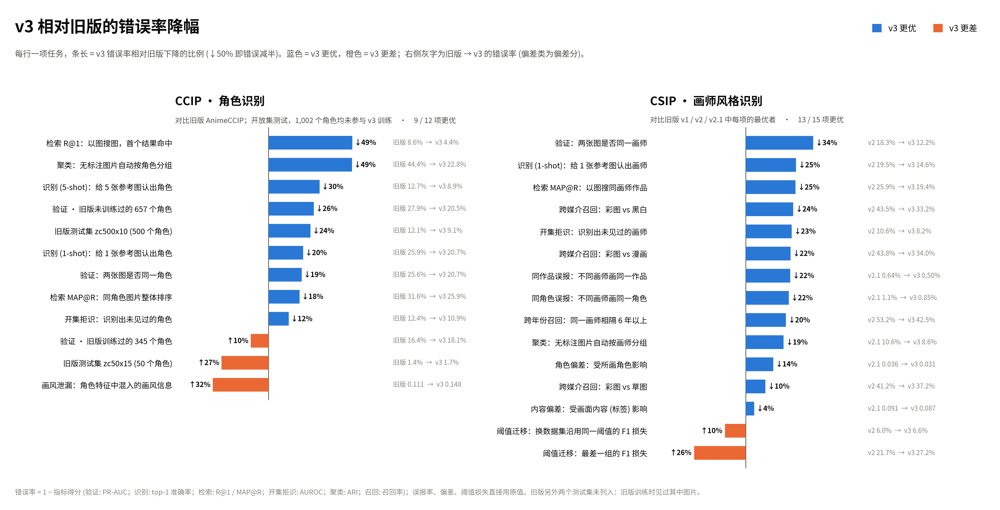
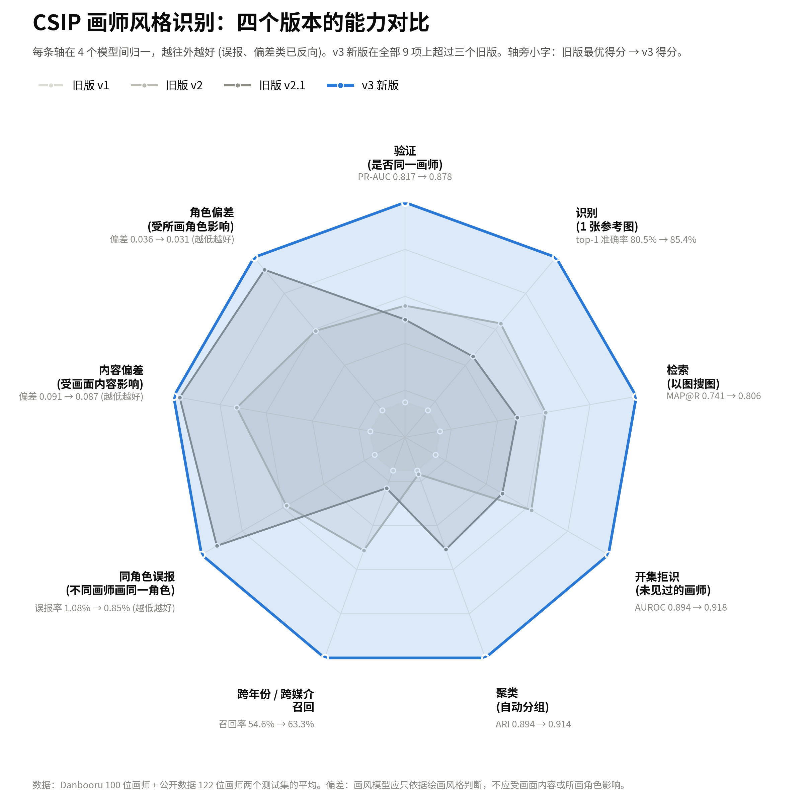
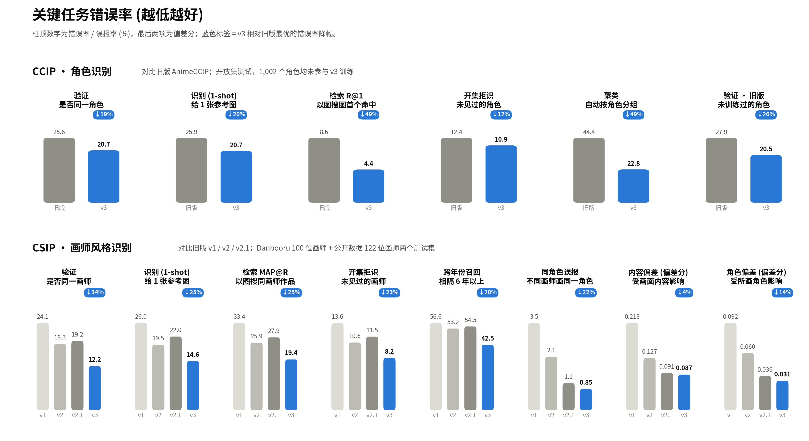
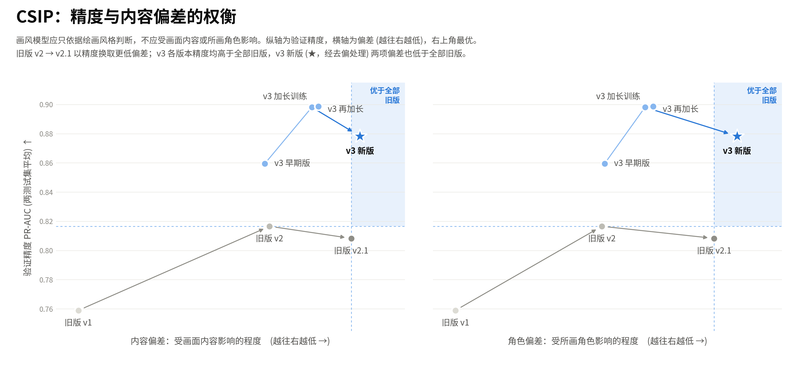

# CxIP v3 实验结果记录

设计见 `cxip_v3_design_2026-10-20_zh.md`。原始数据：`/data/neko/cxip_v3/exps/<exp>/{train,eval}.jsonl`、`eval/suite.json`、`weight_change.json`。
汇总：`python -m v3.scripts.summarize_p1 /data/neko/cxip_v3/exps/ccip_p1`。

## M0 (2026-10-20)

### 冻结 AnimeDINOv3 特征 (0.6 / 0.9)

旧 merged test 抽样 (1500 类 / 8900 张，闭集，与训练无关)：

| 特征 | 256 | 384 | 512 |
|-|-|-|-|
| 最终层 CLS | 0.284 | 0.332 | 0.350 |
| patch 均值 | 0.128 | 0.146 | 0.154 |
| 第 12 / 18 层 CLS (未归一化) | 0.006 / 0.029 | 0.006 / 0.033 | 0.006 / 0.032 |

- 分辨率单调变好：位置编码插值到 384/512 没有坏处。
- 中间层直接算 cos 几乎没有区分力。原因是残差流有少数巨大通道，必须逐层 LayerNorm (CSIP 画风头已这样做)。

开放集 (`ccip_openset_v1`)：冻结 CLS @384 FULL PR-AUC **0.341**，FAST 0.409。

### 吞吐

见设计文档 §5.1。默认：全量 + 丢 50% patch + 按 block compile + 部分 checkpoint (10/24 个 block)，每卡 bs128，4 卡 DDP。

## CCIP P1 (300k 样本，384，全局 batch 512，开放集评测)

| 实验 | FULL PR-AUC | 新作品 | 同作品难例 | 骨干见过 | 骨干没见过 | M512 / M256 / M128 | I_style |
|-|-|-|-|-|-|-|-|
| 冻结 CLS | 0.341 | | | | | | |
| base (全量，LLRD 0.85) | 0.717 | | | | | | |
| ft_last12 | 0.718 | 0.731 | 0.743 | 0.794 | 0.746 | 0.722 / 0.720 / 0.706 | 0.135 |
| ft_lora (r32) | 0.709 | 0.713 | 0.736 | 0.784 | 0.736 | 0.712 / 0.709 / 0.698 | 0.133 |

参考：HF AnimeCCIP 的 I_style (回归版) = 0.143 (**旧口径**：4,887 张有缓存特征的子集)。v3 探针 (9,509 张) 同口径重测 HF 为 **0.111** (2026-10-23)，以下各处 "旧模型 0.143" 的比较均应以 0.111 为准。

训练内 FAST 评测 (300 类，完整套件待补)：base 0.759；loss_arc_only 0.760；pool_cls 0.756；ft_lora 0.752；loss_siglip_only **0.739**。
- ArcFace 是主力，单独 SigLIP 掉 0.02。
- query pool 对比 CLS 只高 0.003，需要 base_seed1 给出的种子方差才能判断。
- pool_cls 的 img/s 偏低是因为同时在 GPU 4 上跑了 CSIP 诊断，不代表真实吞吐。

要点：
- 只训最后 12 层和全量打平，吞吐高 1.6 倍。LoRA 略差，未合并时也不更快 (反传仍要过全部层)。
- Matryoshka 有效：128 维只掉 0.012。
- 骨干预训练监督过的角色 (seen) 比没见过的高约 0.05。报告必须分组。
- 画风泄漏没有改善 (0.135)：合并数据的类内正样本大多同画风。需要跨画风正样本 (依赖新 CSIP)，因此 CSIP 提前。
- 短预算下的修正：
  - ArcFace 类中心用 weight imprinting 初始化 (32k 类每类只被访问约 2 次，随机中心学不动)。
  - LLRD 下的 ΔW 被学习率支配，看不出层偏好，因此加了统一学习率的分段 surgical FT。
- base / ft_last12 用的是 17:29 之前的 series 索引，之后的实验是新版。用 base_rerun 量化差异。

### ArcFace 只用 batch 内负类 (arc_negatives='batch')

训练内 FAST PR-AUC 轨迹 (第 195 / 390 / 585 步)：

| 实验 | 195 | 390 | 585 |
|-|-|-|-|
| base | 0.748 | 0.763 | 0.759 |
| ft_last12 | 0.752 | 0.764 | 0.762 |
| ft_last12_rerun (新 series 索引) | 0.747 | 0.768 | 0.761 |
| loss_arc_only | 0.746 | 0.767 | 0.760 |
| loss_siglip_only | 0.687 | 0.724 | 0.739 |
| **l12_arc_batchneg** | 0.730 | 0.771 | **0.771** |
| l12b_seed1 (同配置，seed=1) | 0.727 | 0.773 | 0.778 |
| l12b_xstyle (+跨画风数据) | 0.744 | 0.771 | 0.782 |

- 所有用 ArcFace (全类 softmax) 的实验在 390→585 都回落 0.002-0.008，只有不用 ArcFace 的 siglip_only 一直上升。
- 原因与 CSIP 坍缩相同：imprint 过的旧中心越积越多，在 softmax 里占比越来越大，"推离旧中心" 的整体平移力越来越强。CCIP 的头身份信号强，没有坍缩，表现为后期回落。
- batch 内负类：FULL +0.007 (0.7243 vs ft_last12 0.718，两个种子)，FAST +0.011~0.016，且不回落。代价是 I_style 略升 (0.135 → 0.140)。
- **种子噪声**：同配置换种子，FAST 差 0.007 (0.771 vs 0.778)，FULL 只差 0.001 (0.7238 vs 0.7247)。FAST 是 300 类子集，噪声大，结论以 FULL 为准。
- xstyle：FAST +0.004 但 FULL −0.008，不采用，见下文数据一节。
- 后续 CCIP 非层类消融都叠加这一项 (前缀 l12b_)。

### 预算斜率与分段 surgical FT (2026-10-21)

| 实验 | FULL | 新作品 | 同作品难例 | 骨干见过 | 骨干没见过 | I_style |
|-|-|-|-|-|-|-|
| l12b (300k，两种子平均) | 0.724 | 0.747 | 0.750 | 0.811 | 0.747 | 0.140 |
| **l12b_x4 (1.2M)** | **0.751** | **0.770** | **0.778** | 0.825 | **0.777** | 0.150 |
| blk00_07 (只训 0-7 层，统一 lr) | 0.661 | 0.677 | 0.687 | 0.749 | 0.689 | |
| blk08_15 (只训 8-15 层，统一 lr) | 0.696 | 0.709 | 0.722 | 0.777 | 0.725 | |
| blk16_23 (只训 16-23 层，统一 lr) | 0.718 | 0.727 | 0.744 | 0.793 | 0.742 | |

- 4 倍预算 FULL +0.027 (CSIP 为 +0.10)，主要来自骨干没见过的角色。训练内 FAST 在 800k 后走平 (0.765 / 0.774 / 0.790 / 0.793 / 0.795 / 0.794)。CCIP 最终预算 2-3M 足够。
- **画风泄漏随训练变长而升高** (0.140 → 0.150，旧模型 0.143)，与 CSIP 内容偏置随预算下降相反：CCIP 的同类正样本大多同画风，画风是 ArcFace 的有效捷径。候选对策：用新 CSIP 给 CCIP 训练图聚类出伪画师，在 batch 里放 "同画风、不同角色" 的负例 (CSIP 同角色交叉成组的镜像)。
- Matryoshka 512 维 (0.754) 略高于 768 维。
- 分段 FT (三段都用全类 ArcFace，对照 ft_last12 0.718)：0-7 层 0.661 < 8-15 层 0.696 < **16-23 层 0.718**。只训最后 8 层就与只训后 12 层、全量持平：CCIP 的适配几乎全在最后 8 层，C′ 的假设成立 (冻结特征的 CKA 分析与真实微调结论一致)。CCIP final 可以只训最后 8 层 (ft_last6 检验能否更少)。

### l12b 配方消融 (300k，FULL；参照 l12b 两种子平均 0.7243，种子差 0.001)

| 实验 | FULL | 新作品 | 同作品难例 | 骨干见过 | 骨干没见过 | I_style | 结论 |
|-|-|-|-|-|-|-|-|
| l12b_no_lp (去掉 LP 阶段) | **0.7317** | 0.755 | 0.757 | 0.815 | 0.755 | 0.138 | +0.007，去掉 LP |
| l12b_res512_tail (末 15% 512，评测 512) | **0.7348** | 0.757 | 0.760 | 0.816 | 0.758 | 0.141 | 收益全部来自推理分辨率 (见下行)，训练尾段不需要 |
| l12b_seed1 (384 训练) 在 512 评测 | **0.7397** | 0.754 | 0.766 | 0.821 | 0.762 | | 384 评测 0.7247 → +0.015：CCIP 训 384、推理 512 |
| l8b (只训最后 8 层) | 0.7227 | 0.748 | 0.748 | 0.810 | 0.744 | 0.141 | 持平，可省 1/3 反传 |
| l12b_samp_alpha1 (按图片数采样) | 0.7305 | 0.755 | 0.766 | **0.847** | **0.736** | 0.134 | 偏向常见角色，没见过的 −0.011，不采用 |
| l12b_samp_nogroup (不做同作品成组) | 0.7195 | 0.733 | 0.746 | 0.807 | 0.741 | 0.141 | −0.005，保留成组 |
| l12b_pool_cls_mean | 0.7253 | 0.749 | 0.751 | 0.812 | 0.746 | 0.138 | 持平，保留 query |
| l12b_lr4e-5 (学习率 ×2) | 0.7186 | 0.753 | 0.742 | 0.804 | 0.745 | 0.151 | −0.006，保持原学习率 |
| ft_last6 (全类 ArcFace，对照 ft_last12 0.718) | 0.7169 | 0.721 | 0.744 | 0.795 | 0.739 | 0.135 | 持平 |

### C′ 逐层分析 (CKA)

`python -m v3.scripts.cka_report /data/neko/cxip_v3/exps/ccip_p1`：用 512 张固定评测图，计算微调后与原始 AnimeDINOv3 逐层特征的线性 CKA (1 = 未变)。

| 实验 | L8 CLS | L12 | L16 | L20 | L24 | FAST |
|-|-|-|-|-|-|-|
| base (LLRD 0.85) | 1.000 | 0.994 | 0.926 | 0.876 | 0.671 | 0.759 |
| ft_last12 | 1.000 | 1.000 | 0.951 | 0.875 | 0.664 | 0.762 |
| ld100 (统一学习率) | 0.967 | 0.940 | 0.871 | 0.787 | 0.608 | 0.758 |
| ft_lora | 0.986 | 0.969 | 0.895 | 0.857 | 0.717 | 0.752 |
| l12_arc_batchneg | 1.000 | 1.000 | 0.960 | 0.884 | 0.742 | 0.771 |
| l12b_seed1 | 1.000 | 1.000 | 0.969 | 0.897 | 0.746 | 0.778 |
| l12b_xstyle | 1.000 | 1.000 | 0.970 | 0.869 | 0.754 | 0.782 |

- LLRD 下前 12 层几乎不动，改动集中在 16-24 层。
- 统一学习率让前半段真的改变了，但没有收益。
- batch 内负类的 L24 CKA 更高 (0.74 vs 0.66)：精度更高、对骨干的改动反而更小，与 "旧中心带来整体平移" 的解释一致。
- 结论：CCIP 不需要改动前半段骨干，冻结前 12 层是最终配方候选 (吞吐 1.6 倍)。分段 surgical 实验 (blk00_07 / 08_15 / 16_23) 跑完后再确认。

## CCIP v3 teacher (final/ccip_teacher_v1，2026-10-22 14:26 完成)

配方 (`v3/configs/ccip_final.py`)：ccip_p1_base + 伪画师交叉成组 (cross_key='pseudo_artist'，0.25) + 只训最后 8 层 + ArcFace 只用 batch 内负类，3M 样本，384 训练，不做 LP。

| | FULL PR-AUC | M512 / M256 / M128 | I_style (回归 / 分类) |
|-|-|-|-|
| **teacher_v1 @512** | **0.793** | 0.792 / 0.787 / 0.778 | 0.148 / 0.721 |
| teacher_v1 @384 | 0.780 | 0.779 / 0.773 / 0.764 | |
| l12b_x4 (P1 最优) | 0.751 | 0.754 / 0.750 / 0.740 | 0.150 / 0.726 |
| l12b_pa | 0.731 | 0.734 / 0.734 / 0.724 | 0.134 / 0.701 |

### 与旧版 HF AnimeCCIP 对比 (同一 v3 开放集 FULL 套件；`v3/scripts/eval_hf_ccip.py`，HF 用自带预处理与 logit_scale/bias)

| 指标 (openset_full) | HF AnimeCCIP | v3 teacher_v1 @512 |
|-|-|-|
| PR-AUC | 0.744 | **0.793** |
| best F1 | 0.703 | **0.742** |
| zero-shot top1 (1 张参考) | 0.740 | **0.789** |
| N-way top1 (1 / 5 张参考) | 0.741 / 0.873 | **0.793 / 0.911** |
| 检索 MAP@R / R@1 | 0.684 / 0.914 | **0.741 / 0.956** |
| OOD (N500/X500，1 张参考) AUROC / F1 | 0.876 / 0.797 | **0.891 / 0.823** |
| I_style 回归 / 分类 (越低越好，同一 9,509 张) | **0.111 / 0.621** | 0.148 / 0.721 |
| 分组：新作品 | 0.755 | **0.796** |
| 分组：同作品难例 | 0.789 | **0.822** |
| 分组：骨干见过 | **0.920** | 0.863 |
| 分组：骨干没见过 | 0.727 | **0.812** |

训练数据重叠：HF AnimeCCIP 是在 zerochan (zerochan-character-w640-ws-m50-full，5,031 个角色) 上训练的；开放集只剔除了 v3 训练集里的类，来源含 zerochan (zc800k) 的评测类很可能在 HF 的训练集里。按来源拆开 (PR-AUC)：

| 子集 | 类 / 图 | HF | v3 | Δ |
|-|-|-|-|-|
| zerochan 来源 (HF 可能训练过) | 345 / 13,800 | **0.836** | 0.819 | −0.017 |
| 非 zerochan 来源 (HF 没训练过) | 657 / 8,701 | 0.721 | **0.795** | **+0.074** |
| 骨干见过 ∩ zerochan | 184 / 7,360 | **0.928** | 0.864 | −0.064 |
| 骨干见过 ∩ 非 zerochan | 28 / 545 | 0.954 | **0.971** | +0.016 |
| 骨干没见过 ∩ zerochan | 135 / 5,400 | 0.846 | **0.853** | +0.008 |
| 骨干没见过 ∩ 非 zerochan | 592 / 7,211 | 0.750 | **0.808** | +0.058 |

- v3 在所有 HF 没训练过的子集上都更好，开放集 (真正没见过的角色) 上 +0.06~0.07。
- HF 唯一领先的是 "骨干见过 ∩ zerochan"：热门角色、且大概率在 HF 训练集里，属于闭集记忆，不代表泛化。
- "骨干见过" 分组 HF 领先 (0.920 vs 0.863) 也来自这部分重叠 (该分组 93% 的图来自 zerochan)。
- **画风泄漏 v3 更高**：同口径下 HF 0.111 / 0.621，v3 0.148 / 0.721 (分类版：从 CCIP 向量猜 100 个画师，v3 多拿 0.10)。早先 "与旧模型持平 (0.143)" 的判断来自不同口径，作废。伪画师交叉成组没把泄漏降下来，CCIP 去画风是下一步要做的事 (CSIP 那边的事后线性擦除可直接借用：拟合 CCIP 向量 → CSIP v3 向量的方向)。
- 评测路径验证：同一脚本在 zc500x10 上复现 HF 旧数字 0.8794 (原 0.8794)，HF 的开放集数字可信。

聚类 (UMAP 35 维 + HDBSCAN，扫 min_cluster_size 2-7 取 NMI 最优；`/data/neko/cxip_v3/eval/clustering_openset_*.json`)：

| 集合 | 模型 | 簇数 / 真类数 | 噪声比例 | NMI | ARI | 纯度 / 逆纯度 |
|-|-|-|-|-|-|-|
| openset_fast (2,709 张) | HF | 281 / 300 | 5.4% | 0.933 | 0.556 | 0.901 / 0.933 |
| | **v3** | 292 / 300 | **2.5%** | **0.957** | **0.772** | **0.919 / 0.943** |
| openset_full (22,501 张) | HF | 904 / 1,002 | 7.6% | 0.913 | 0.252 | 0.912 / 0.912 |
| | **v3** | 866 / 1,002 | **5.1%** | **0.937** | **0.423** | **0.920 / 0.913** |
| zc500x10 (5,000 张) | HF | 481 / 500 | 1.7% | 0.972 | 0.824 | 0.937 |
| | **v3** | 486 / 500 | 1.1% | **0.980** | **0.888** | **0.955** |

- 开放集上聚类 v3 全面更好，ARI 提升最大 (FAST +0.22，FULL +0.17)：HF 更容易把不同角色并成大簇。FULL 的 ARI 两者都低，是 1,000 类规模下少数大簇合并所致。

旧闭集评测集 (HF 卡片上的数字；v3 @512，`eval_r512/suite.json`)：

| 集合 | 指标 | HF | v3 |
|-|-|-|-|
| zc500x10 (500 类) | PR-AUC / zero-shot top1 / MAP@R | 0.879 / 0.872 / 0.821 | **0.909 / 0.921 / 0.878** |
| zc50x15 (50 类) | PR-AUC / zero-shot top1 / 聚类 NMI | 0.986 / 0.981 / 0.996 | 0.983 / 0.984 / 0.993 |
| ccip_eval (10 类) | PR-AUC / 聚类 NMI | 1.000 / 0.986 | 0.998 / 0.946 |
| test_ccip (42 类) | PR-AUC / zero-shot top1 / 聚类 NMI | **0.994 / 1.000 / 1.000** | 0.957 / 0.958 / 0.987 |
| ccip_test_v1 (43 类) | PR-AUC / zero-shot top1 / 聚类 NMI | **0.992 / 0.997 / 0.997** | 0.955 / 0.970 / 0.991 |

- 这些图都不在 v3 训练集里 (按 zerochan id 0 张重合；sha256 完全相同的 zc500x10 1 张、zc50x15 2 张)。
- 唯一规模够大的 zc500x10 上 v3 明显更好 (+0.03 PR-AUC，+0.05 zero-shot)。
- test_ccip / ccip_test_v1 (实为同一批 42-43 类) 上 v3 低 0.04：v3 只有 5/328 个最近邻错误，掉分来自跨类的分数尺度不齐 (排序问题，不是认不出)，拖分分散在多个类上。HF 在这两个集合上 zero-shot 100%，图片文件名是 zerochan id，而 HF 正是用 zerochan 训练的，可能见过这些图或同源图；没有 HF 训练清单无法证实。
- ccip_eval 只有 10 类、已饱和，聚类 NMI 差异 (0.986 vs 0.946) 来自个别大类被拆成两簇。

### 剩余错误分析 (openset_full，best-F1 阈值；样例图 `/data/neko/cxip_v3/eval/ccip_err/`)

- 正对 347,836 个：v3 漏判 110,040 (31.6%)，HF 漏判 119,326；**两者都漏的 74,276 个 = 全部正对的 21%**，占 v3 漏判的 67%。这部分是两个模型共同的下限。
- 负对误报：v3 54,988，HF 74,130，重合只有 24%：两者犯的是不同的错。
- v3 最差的 24 个正对 (cos ≈ 0) 几乎全是 "同名不同样"：形态/变身 (阿尔冯斯盔甲 vs 人形、露琪亚人鱼形态、奥泽美咲的熊玩偶装、小鸟游宗太女装)、皮肤 (LoL 的 Akali / Jinx)、拟人化概念角色 (黑塔利亚的国家)、真人或歌い手 (GACKT、Nico 歌手)、疑似标签错误；HF 在这些对上也全部低于其阈值。
- v3 分数最高的 24 个负对里约 9 个是标签/定义问题：同一角色两个名字 (Axel / Lea、雪女 / 刹罗)、平行世界版本 (木之本樱 / TRC 樱)、设计相同的亲属 (泉此方 / 泉奏多)、双胞胎 (柊镜 / 柊司)、多人封面图。其余是同作品相似设计，以及 **同服装捷径** (排球部同款队服 Daichi / Osamu：v3 0.89，HF 0.55)。
- 结论：开放集 PR-AUC 的上限明显低于 1 (约 1/5 的正对按外观本身就难以判定)，绝对值差距会低估模型差距；按错误率算，v3 相对 HF 的减少为 PR-AUC 误差 −19%、检索 R@1 错误 −49%、5 参考 N-way 错误 −30%、zc500x10 zero-shot 错误 −38%。
- 是否严格在 HF 训练集里只能按来源推断 (没有 HF 训练类清单)；m50 子集只取 ≥50 张的角色，实际重叠可能小于 345 类。

## CSIP P2

### LP 阶段坍缩：根因与修复 (2026-10-20)

现象：csip_p2/base 在 LP (只训头) 的前 40 步内，batch 内异类 emb cos 从 0.2 升到 0.82，训练内评测接近随机。
第一次修复 (统计量加 BN 中心化，去掉所有图片共有的大分量) 只把初始 cos 从 0.93 降到 0.2，坍缩照样发生。

复现：缓存真实 LP 前 64 个全局 batch 的冻结骨干统计量 (相同 sampler / 增强 / patch drop)，只训头。
坍缩轨迹与真实训练一致 (第 40 步 0.81 对比 0.82)。t100 PR-AUC (LP 64 步后；冻结 CLS 为 0.199)：

| 变体 | 异类 cos | t100 PR-AUC |
|-|-|-|
| 原配置 (ArcFace + imprint + SigLIP) | 0.90 | 0.080 |
| 只用 ArcFace | 0.98 | |
| 只用 SigLIP | 0.30 | 0.327 |
| 不 imprint | 0.36 | 0.021 |
| ArcFace 负类只取 4 / 16 步内见过的类 | 0.86 / 0.87 | 0.097 / 0.085 |
| **ArcFace 负类只取当前全局 batch 内的类** | 0.37 | **0.326** |
| BNNeck (输出 embedding 做无偏置 BN) | 0 (构造保证) | 0.246 |

根因：
- 38,761 个画师，LP 内每类平均只被访问 0.2 次。batch 外的类中心都是用较旧的头参数 imprint 出来的，相对当前 embedding 整体偏移。
- 所有样本共享同一批这样的难负例，"推离负例" 对每个样本都是同一方向的力。球面上的整体平移会把所有点挤到一处，也就是坍缩。
- 新的 embedding 又被 imprint 成下一批旧中心，形成正反馈。
- 哪怕只用 4 步前的中心也坍缩；只用同一步 imprint 的中心时，它们正好位于当前分布中央，推离方向是径向发散，不会坍缩。
- 本质是 memory bank 不一致 (MoCo 用动量编码器解决的问题)。
- 1024 类的离线模拟每类被反复访问，不存在旧中心，所以复现不出来。CCIP (32k 类) 的头一开始就有很强的身份信号，没有坍缩，但旧中心可能同样在拖慢学习。

修复：`loss.arc_negatives='batch'`，即 ArcFace 的 softmax 只在当前全局 batch 内出现的类上计算。CSIP 默认开启。
BNNeck 能防坍缩但掉点，不采用。

CCIP 用 `ccip_p1/arc_batchneg` 检验旧中心是否同样在拖累它。坍缩的两次运行保留在 `csip_p2/_base_collapsed_{noBN,statBN}`。

### csip_p2/base 结果与旧 CSIP 的差距 (2026-10-20)

训练内 t100 (test100_0918 每类 30 张) PR-AUC：0.471 → 0.521 → 0.552 (第 100k / 200k / 300k 样本)，预算结束时仍在上升。

完整评测 (crop384) 与旧模型在同一数据集上对比：

| 模型 | test100_0918 (22,559 张) | test100 |
|-|-|-|
| HF CSIP v1 | 0.745 | 0.588 |
| HF CSIP v2 | 0.792 | 0.838 |
| HF CSIP v2.1 | 0.744 | 0.925 |
| csip_p2/base (300k 样本) | **0.479** | 0.380 |

- 公平对比集是 test100_0918：v2.1 在 0918 切分上训练、该切分的测试画师被留出；旧的 test100 很可能被 v2/v2.1 训练时见过。
- 差距约 0.27-0.31。

输入协议 (不重训，test100_0918 每类 40 张)：

| 协议 | PR-AUC |
|-|-|
| crop384 (当前) | 0.554 |
| squash384 (旧 CSIP 的做法) | 0.558 |
| padres384 | 0.493 |
| native_full (整图原尺度) | 0.592 |

- 画风头只用 patch 统计量，对尺寸和位置不敏感，可以直接吃整图原尺度。native_full +0.04，最终评测改用它 (同样先限制短边 ≤640)。
- 协议只解释一小部分差距，主要原因是预算 (300k 对比旧模型多 epoch) 或配方。
- 新增 head_query (CCIP 同款 query 头) 与 stats_cls (统计量 + 各层 CLS) 对照。设计文档记录冻结 CLS 线性探针 CSIP 达 91.3%，CLS 里画师信息很多。

### CSIP P2 消融 (训练内 t100，第 195 / 390 / 585 步)

| 实验 | 195 | 390 | 585 |
|-|-|-|-|
| base (ArcFace batch 负类 + SigLIP，统计量头) | 0.471 | 0.521 | 0.552 |
| cross0 (不做同角色交叉成组) | 0.449 | 0.532 | 0.548 |
| **loss_siglip_only** | 0.481 | 0.549 | **0.599** |
| head_query (CCIP 同款 query 头) | 0.465 | 0.544 | 0.573 |
| **q_siglip (query 头 + 只用 SigLIP)** | **0.520** | **0.605** | **0.641** |

- CSIP 上只用 SigLIP 反而好 0.047，与 CCIP 相反 (CCIP 上 ArcFace 是主力)。可能原因：同一画师作品的差异远大于同一角色，动态 margin (小类最高 0.5) 强行压紧类簇。
- 同角色交叉成组对原始 PR-AUC 没有影响，去偏效果要看 bias 探针。
- q_siglip：两项改动的收益超过简单相加 (0.021 + 0.047 → 实际 +0.089)，而且学得更快。
  - 我设计的 "patch 统计量画风头" (Gram 式纹理先验) 输给了自己学注意力的 query 头。AnimeDINOv3 末层 token 已经编码了大量画师信息，手工设计的统计量瓶颈反而丢掉了构图、配色等线索。
  - ArcFace 帮 CCIP、伤 CSIP：画师类内差异大，固定 margin 的代理分类不合适；SigLIP 的成对 sigmoid 只要求 "比负例更像"，更宽容。
- 其余 CSIP 消融改在 q_siglip 上做 (前缀 q_)。去掉了统计量头专用消融 (stats_cls / stats_mean / layers_*) 和 LoRA。
- 新增：4 倍预算探针 q_x4 (估计预算斜率)、q_seed1 (种子方差)、q_ft_last12 (提速)。

### CSIP 完整套件 (2026-10-20 晚，csip_eval_public 已做尺度对齐)

| 模型 | test100_0918 | test100 | csip_eval_public | I_content ↓ | I_char ↓ |
|-|-|-|-|-|-|
| HF CSIP v1 | 0.746 | (泄漏) | 0.773 | 0.213 | 0.092 |
| HF CSIP v2 | 0.792 | (泄漏) | 0.841 | 0.127 | 0.060 |
| HF CSIP v2.1 | 0.745 | (泄漏) | 0.872 | 0.091 | 0.036 |
| base (统计量头 + ArcFace + SigLIP，300k) | 0.479 | 0.380 | 0.597 | 0.188 | 0.064 |
| cross0 | 0.483 | 0.388 | 0.612 | 0.193 | 0.068 |
| loss_siglip_only (统计量头 + SigLIP) | 0.567 | 0.430 | 0.605 | 0.147 | 0.054 |
| head_query (query 头 + ArcFace + SigLIP) | 0.523 | 0.453 | **0.391** | **0.278** | 0.086 |
| q_siglip (query 头 + SigLIP，300k) | 0.627 | 0.488 | 0.601 | 0.215 | 0.063 |
| q_siglip，native_full 协议 | 0.687 | | 0.610 | | |
| q_seed1 (q_siglip，seed=1) | 0.621 | 0.482 | 0.589 | 0.215 | 0.064 |
| q_ft_last12 (冻结前 12 层) | 0.610 | 0.475 | 0.597 | 0.217 | 0.064 |
| q_res512 (crop512 协议) | 0.691 | 0.545 | 0.650 | 0.222 | 0.066 |
| q_res512，native_full 协议 | 0.715 | | 0.671 | | |
| q_cross0 (不做同角色交叉成组) | 0.609 | 0.483 | 0.567 | 0.217 | 0.068 |
| **q_x4 (q_siglip，1.2M)** | **0.722** | **0.623** | **0.682** | **0.151** | 0.063 |
| **q_x4，native_full 协议** | **0.782** | **0.693** | **0.744** | | |
| q_x4_arc (q_x4 + ArcFace，1.2M) | 0.601 | 0.515 | 0.510 | 0.224 | 0.083 |

`python -m v3.scripts.summarize_suite /data/neko/cxip_v3/exps/csip_p2` 生成。

- **种子噪声** (q_siglip vs q_seed1)：test100_0918 0.006，csip_eval_public 0.012，偏置几乎不变 (0.215 / 0.215)。CSIP 消融差异 <0.01 (0918) 或 <0.02 (public) 不下结论。
- **冻结前 12 层 (q_ft_last12)**：0918 −0.014 (噪声 0.006)，public 持平，吞吐 1.45 倍 (650 vs 450 img/s)。CKA 显示 CSIP 全量微调会改动前 12 层 (L12 0.98，q_x4 更多)，CCIP 完全不动：画风依赖笔触、纹理等低层特征。最终 CSIP 用全量微调。
- **512 训练 (q_res512)**：native 协议下 +0.028 (0918) / +0.061 (public)，但单价 2.1 倍 (216 vs 452 img/s)。按预算斜率折算，同算力下 384 多训 (约 630k 样本) 预计 0.74 / 0.68，不比 512 差。最终配方：384 为主，末 15% 换 512 (FixRes，让训练分辨率接近整图推理)。
- **同角色交叉成组有用 (q_cross0)**：去掉后 0918 −0.016、public −0.028 (噪声 0.006 / 0.012)，I_char 略升 (0.064 → 0.068)。训练内 t100 看不出差别 (0.632 vs 0.641 / 0.634)，完整套件才看得出。最终配方保留。
- **预算是主杠杆**：4 倍预算三个集合 +0.08~0.14，约每倍 +0.05，1.2M 时仍在上升 (训练内 t100：0.592 / 0.655 / 0.688 / 0.720 / 0.731 / 0.743)。内容偏置同时从 0.215 降到 0.151：学到画风后不再依赖内容捷径。最终 CSIP 需要 ≥5M 样本。
- **整图原尺度 (native_full，短边 ≤640) 对 query 头 +0.06~0.07**，大于统计量头的 +0.04：query 头能看到整幅构图与配色。训练只见过 384 裁剪，整图推理仍更好，AnimeDINOv3 的动态分辨率泛化好。q_x4 在 test100_0918 上已超过 v1 / v2.1，距 v2 (0.792) 0.01。q_siglip (300k) 的 native 增益为 +0.060 / +0.009 (test100_0918 / public)，q_x4 为 +0.060 / +0.062：test100_0918 上增益稳定，crop 协议下的消融排序可以直接沿用。最终评测用 native_full；最终训练考虑提高分辨率或后期改用整图 (见 q_res512)。
- **ArcFace 在 4 倍预算下依然有害**：q_x4_arc 训练内 t100 在 400k / 800k / 1M 样本时为 0.584 / 0.622 / 0.630，q_x4 同期 0.655 / 0.720 / 0.731。不是短预算假象，最终 CSIP 不用 ArcFace。完整套件：test100_0918 −0.12，csip_eval_public −0.17，I_content 0.151 → 0.224。解释：38k 路分类代理奖励一切能区分画师的特征，"这个画师常画什么" 是最容易的那种；SigLIP 的负例在 batch 内，同角色交叉成组让负例与正例内容相同，直接惩罚靠内容的相似度。
- **query 头 + ArcFace 走内容捷径**：I_content 0.278，分布外的 csip_eval_public 掉到 0.39 (该集合不少画师题材相近，内容相似造成跨画师误配)。只配 SigLIP 时正常。
- 统计量头 + SigLIP 的内容偏置最低 (0.147)，但同分布精度低 0.06。

**csip_eval_public 的尺度问题 (已修复)**：训练数据 danbooru-w640-ws 已统一短边 640 ("原尺度" 指这个尺度)。csip_eval_public 是原图 (短边中位数 800)，原尺度裁剪时笔触被放大 1.3-1.7 倍。CSIP 评测预处理现在先把短边缩到 ≤640 (`transforms.limit_short_side`，只缩不放；`eval_exp --short-side 0` 可关闭)。test100 系列与 bias 集本来就 ≤640，不受影响。cross0：0.578 → 0.612；head_query：0.360 → 0.391。旧特征保留为 `feats/csip_eval_public.noss.npz`。

## CSIP v3 teacher (final/csip_teacher_v1，2026-10-21 09:04 完成)

配置 `v3/configs/csip_final.py`：q_x4 配方，6M 样本，384 → 末 15% 512，末 5% 关 patch drop，EMA 0.999。4×H200 约 5 小时 (384 段 455 img/s，512 段 213 img/s，关 drop 后约 110 img/s)。

训练内 t100 (384 裁剪，EMA)：0.693 / 0.747 / 0.774 / 0.791 / 0.803 / 0.810 / 0.815 / 0.819 / 0.823 (0.5M-5M)，512 收尾后 0.825。

| 模型 | 协议 | test100_0918 | test100 | csip_eval_public | I_content ↓ | I_char ↓ |
|-|-|-|-|-|-|-|
| HF CSIP v1 | 旧 (384 压缩) | 0.746 | (泄漏) | 0.773 | 0.213 | 0.092 |
| HF CSIP v2 | 旧 | 0.792 | (泄漏) | 0.841 | 0.127 | 0.060 |
| HF CSIP v2.1 | 旧 | 0.745 | (泄漏) | **0.872** | **0.091** | **0.036** |
| v3 teacher (EMA) | crop384 | 0.805 | 0.787 | 0.777 | 0.130 | 0.060 |
| v3 teacher (EMA) | native_full | 0.864 | 0.852 | 0.850 | | |
| **v3 teacher (非 EMA)** | native_full | **0.870** | | 0.849 | | |

- 公平留出集 test100_0918：0.870，比最好的旧模型 (v2 0.792) 高 0.078。
- csip_eval_public：0.850，超过 v1 / v2，低于 v2.1 (0.872)。v2.1 的训练可能更贴近该集合的分布 (它在 0918 上只有 0.745)。
- 偏置与 v2 持平 (0.130 / 0.060)，仍高于 v2.1。
- EMA 没有收益 (0918 −0.006，public +0.001)：cosine 衰减到 1% 已起到平均作用。发布与蒸馏用非 EMA 权重 (`last_raw.pt`)。
- Matryoshka (native，EMA)：512 维 0.856、256 维 0.845、128 维 0.819。

## CSIP 错误分析 (teacher 非 EMA，native_full，test100_0918；`v3/scripts/csip_error_analysis.py`)

best-F1 阈值 (cos 0.476) 下按配对属性拆解：

| 正对 (同画师) 分桶 | 占正对 | 召回 | 占漏检 |
|-|-|-|-|
| 年份差 0 | 17% | 0.877 | 9% |
| 年份差 1-2 | 31% | 0.859 | 18% |
| 年份差 3-5 | 27% | 0.750 | 27% |
| **年份差 ≥6** | 25% | **0.550** | **47%** |
| 彩色-彩色 | 79% | 0.773 | 73% |
| 彩色-黑白 / 草图 / 漫画 | 18% | 0.64-0.69 | 25% |
| 同作品 / 不同作品 | 27% / 73% | 0.885 / 0.708 | 12% / 88% |

- **画风随年份漂移是最大误差源**。按画师算，mAP 与年份跨度的 Spearman 相关为 −0.35 (图数 +0.18，黑白占比 −0.02)。最差的 6 个画师跨度都在 10-19 年。
- **小图是独立因素**：短边 <600 的图占 14%，2009 年前占 31%。固定年份差后，含一张小图的正对召回低约 0.13 (年份差 0-2：两张都是全尺度 0.883，一张小图 0.755)。训练数据和评测都只缩不放。
- 负对误报：同角色 18.6e-3、同作品 8.0e-3，总体 2.4e-3。内容偏置的误报率是平均的 3-8 倍，但这类对少，只占误报的约 15%。

## CSIP 去偏一轮 (2026-10-21)

### 事后线性擦除 (截断 LEACE，`v3/scripts/posthoc_erase.py`；teacher EMA，crop384)

擦除器在偏置探针自己的训练划分上拟合 (内容 8k 张：tagger 标签去掉画风/媒介类；角色 4k 张：CCIP 向量)。k = 擦掉的方向数。

| 擦除 | k | test100_0918 | csip_eval_public | I_content | I_char |
|-|-|-|-|-|-|
| 无 | 0 | 0.805 | 0.777 | 0.130 | 0.060 |
| 内容 | 8 | 0.764 | 0.792 | 0.090 | 0.047 |
| 内容 | 16 | 0.714 | 0.800 | 0.070 | 0.039 |
| 内容 | 32 | 0.670 | **0.804** | 0.052 | 0.033 |
| 角色 | 8 | 0.769 | 0.784 | 0.117 | 0.025 |
| 角色 | 16 | 0.740 | 0.797 | 0.110 | 0.015 |
| 内容+角色 | 8+8 | 0.735 | 0.798 | 0.081 | 0.023 |

- 两个测试集方向相反：擦得越多，0918 掉得越多，public 先升后降。这与 HF v2 和 v2.1 的差别一致：0918 的画师常画固定作品，作品/角色在那里是有用的线索；public 则会惩罚它。
- 线性擦除不是免费的。内容/角色信息和 0918 上有判别力的方向纠缠在一起，偏置降一半要付 0.04-0.09 的 0918。
- 去偏结果要同时看两个测试集，以及同角色负对的误报率 (crosschar)。

### 去偏微调 (从 teacher_v1 非 EMA 权重续训 600k，`v3/configs/csip_debias.py`)

- 对照组 dft_ctrl：同配方续训，不去偏。
- dft_cross50：同角色交叉成组 0.25 → 0.5。
- dft_tag1 / dft_tag01：内容标签混淆擦除，λ = 1 / 0.1 (`v3/debias.py`，Alvi et al. 2018)。
- dft_char1 / dft_char01：角色混淆擦除，λ = 1 / 0.1。

同一框架下还排了 3 个画风提升实验：

- dft_yspread：K 张正样本按年份分层取样。
- dft_gray15：15% 灰度增强。
- dft_r640：640 训练。

结果 (crop = crop384 套件；native = 整图短边 ≤640；同角色误报 = test100_0918 上同角色不同画师负对在 best-F1 阈值下的误报率)：

| 实验 | crop 0918 | crop public | I_content | I_char | 同角色误报 | native 0918 | native public |
|-|-|-|-|-|-|-|-|
| teacher_v1 (crop 用 EMA，native 用非 EMA) | 0.805 | 0.777 | 0.130 | 0.060 | 0.0222 | 0.870 | 0.849 |
| dft_ctrl | 0.811 | 0.768 | 0.129 | 0.058 | 0.0206 | 0.853 | 0.845 |
| dft_cross50 | 0.809 | 0.761 | 0.129 | 0.058 | 0.0206 | 0.853 | 0.842 |
| dft_tag1 | 0.589 | 0.757 | 0.098 | 0.032 | 0.0103 | 0.647 | 0.774 |
| dft_tag01 | 0.743 | 0.821 | 0.110 | 0.045 | 0.0144 | 0.773 | 0.845 |
| dft_tag003 | 0.787 | 0.839 | 0.116 | 0.051 | 0.0170 | 0.815 | **0.876** |
| **dft_tag001** | 0.808 | 0.809 | 0.119 | 0.055 | 0.0187 | 0.844 | 0.866 |
| dft_char01 | 0.495 | 0.652 | 0.141 | 0.027 | 0.0116 | 0.531 | 0.672 |
| dft_char003 | 0.584 | 0.767 | 0.136 | 0.034 | 0.0111 | 0.625 | 0.767 |
| dft_char001 | 0.606 | 0.784 | 0.136 | 0.039 | 0.0135 | | |
| dft_gray15 | 0.807 | 0.764 | 0.131 | 0.060 | 0.0210 | 0.846 | 0.844 |
| **dft_r640** | 0.806 | 0.774 | 0.128 | 0.058 | 0.0237 | **0.884** | 0.848 |
| dft_yspread (正样本按年份分层) | 0.809 | 0.766 | 0.131 | 0.059 | 0.0216 | 0.847 | 0.846 |
| dft_zoom05 (缩放增强 0.5-1.25) | 0.806 | 0.764 | 0.131 | 0.059 | 0.0217 | 0.850 | 0.843 |
| dft_tag001_r512 (tag 0.01 + 后半 512) | 0.805 | 0.820 | 0.115 | 0.055 | 0.0200 | 0.866 | 0.879 |
| **dft_r640_tag001 (640 + tag 0.01)** | 0.801 | 0.830 | **0.110** | **0.053** | 0.0216 | **0.880** | **0.895** |
| dft_r640_tag003 (640 + tag 0.03) | 0.777 | 0.845 | 0.110 | 0.048 | 0.0166 | 0.860 | 0.903 |
| **dft_r640_tag001_x2 (640 + tag 0.01，1.2M)** | 0.804 | 0.854 | **0.108** | 0.051 | 0.0208 | **0.886** | **0.910** |
| dft_r640_tag001_x4 (640 + tag 0.01，2.4M) | 0.812 | 0.850 | 0.106 | 0.049 | 0.0187 | **0.891** | 0.906 |
| dft_c_tag01 (640 + 条件 tag 0.1) | 0.785 | 0.839 | 0.106 | 0.050 | 0.0172 | 0.8645 | 0.897 |
| dft_c_char01 (640 + 条件角色 0.1) | 200k 时训练内 t100 0.661，停掉 | | | | | | |

dft_char1 在 200k 时训练内 t100 已降到 0.40，提前停掉。

结论：
- **对照组本身就掉了 native 0918 −0.017**：只用 384 续训 600k，抹掉了 teacher 末段 512 对整图推理的适配。所有比较都以 dft_ctrl 为基准，定稿要带高分辨率尾段。
- **交叉成组 0.25 → 0.5 无效**：偏置、精度都不变。
- **内容标签混淆擦除有用，但 λ 要小**：
  - λ=0.01：native 0918 −0.009、public +0.021，I_content 0.129 → 0.119。
  - λ=0.03：public 0.876 (超过 v2.1)，0918 −0.038。
  - λ ≥ 0.1：明显伤害，在线擦除器读不出标签，类间 cos 从 0.02 升到 0.13。
  - λ=0.1 的 public 在 crop 上 +0.053，在 native 上 0：crop 协议会高估去偏收益。
- **角色擦除不可用**：λ=0.01 已让 crop 0918 降到 0.61，而且 I_content 反升。Danbooru 里角色与画师高度相关，擦掉角色就擦掉了大半画师信息。
- **灰度增强无效**：彩色-黑白正对召回反而从 0.607 降到 0.576。合成灰度不等于真实黑白稿 (网点、线稿)。
- **640 续训是最大的提升**：native 0918 0.884，比对照 +0.031、比 teacher +0.014。各桶一致提升，彩色-黑白 +0.08、年份差 ≥6 +0.05。训练尺度接近整图推理尺度 (FixRes)。
- **640 与 tag 去偏可叠加**：dft_r640_tag001 的 native 0918 0.880、public 0.895，比 teacher +0.010 / +0.046，偏置 0.110 / 0.053。是目前最优，作为 teacher v2 候选 (λ=0.03 与 2 倍预算在跑)。
- 年份分层正样本 (yspread) 无效，连年份差 ≥6 的桶也没涨 (0.523 → 0.513)。
- 缩放增强 0.5-1.25 (zoom05) 无效。
- 数据层的三种技巧 (年份、灰度、缩放) 都没用，有效的只有训练分辨率和内容去偏。
- 测试时把小图放大到短边 640：0918 +0.002、public −0.009，无用。小图问题只能在训练里解决 (dft_zoom05 待测)。
- 测试集画像：csip_eval_public 多为 Pixiv 原创角色画师，题材 (性别、裸露等) 相近的画师之间容易混，所以惩罚内容捷径；0918 的 Danbooru 画师常画固定作品，作品是有用线索。两者此消彼长，定稿以 native 两集合都不降为准。

### 条件去偏 (2026-10-22，`debias.conditional=True`)

混淆目标从全局先验换成 "该画师的留一概念分布" (向全局先验平滑，β=2)，只擦画师内部的内容差异。
- 训练集上仅凭画师身份 (留一) 就能拿到角色 I≈0.32、标签 I≈0.12：认得出画师的向量天然带内容信息，偏置探针 (相对全局先验) 有一个由画师身份决定的下限。
- 条件 tag λ=0.1 ≈ 全局 λ=0.03 的效果 (I_content 0.106，native 0918 0.8645)，不如全局 λ=0.01 + 长训。
- 条件角色 λ=0.1 同样伤画师信息 (200k 时 t100 0.661，与全局角色 0.01 的 0.710 同级)：训练中的角色擦除无论哪种目标都不可用。

### 事后线性擦除 @ dft_r640_tag001_x2 (native 整图特征，`posthoc_erase.py --test-feats eval_native/feats`)

擦除器在偏置探针的训练划分上拟合，I 在留出划分上测；精度用 native 特征。先擦内容 kc 维，再在擦后的特征上擦角色 kh 维。

| kc / kh | native 0918 | native public | I_content | I_char |
|-|-|-|-|-|
| 0 / 0 | 0.886 | 0.910 | 0.108 | 0.051 |
| 4 / 0 | 0.873 | 0.897 | 0.094 | 0.046 |
| 0 / 4 | 0.875 | 0.895 | 0.100 | 0.032 |
| 3 / 3 | 0.868 | 0.889 | 0.091 | 0.035 |
| **3 / 4** | **0.865** | **0.892** | **0.087** | **0.031** |
| 4 / 3 | 0.865 | 0.887 | 0.089 | 0.034 |
| 4 / 4 | 0.862 | 0.888 | 0.085 | 0.030 |
| 8 / 8 | 0.836 | 0.874 | 0.074 | 0.020 |
| HF v2.1 (目标) | | | 0.091 | 0.036 |

- kc=3 / kh=4 两项偏置都低于 HF v2.1，代价 native 0918 −0.021、public −0.018；相对 teacher_v1 (0.870 / 0.849) 为 −0.005 / +0.043。
- 合成为一个 768×768 仿射映射 `x @ M + b` (再 L2 归一化)，存于 `dft_r640_tag001_x2/eval/posthoc_kc3_kh4.pt`，可直接接在模型输出后。
- 独立验证 (擦除器没见过的指标，`csip_error_analysis.py`，native 0918，best-F1 阈值)：同角色不同画师负对误报 0.0159 → 0.0085 (−47%)，同作品 0.0065 → 0.0050；代价是各桶召回普遍 −0.02~0.03 (总体 0.773 → 0.752)。擦除确实去掉了角色捷径，不只是针对探针。
- 角色擦除比训练内去偏划算得多：训练内角色擦除 λ=0.01 要掉 0.2+，事后 4 维只掉 0.011。

### 4× 长训 (dft_r640_tag001_x4，2.4M，2026-10-22 22:23 完成) 与其上的事后擦除

- 长训本身：native 0918 0.886 → 0.891，public 0.910 → 0.906，I 0.108/0.051 → 0.106/0.049，同角色误报 0.0208 → 0.0187。1× → 2× 收益明显，2× → 4× 基本饱和 (0918 +0.005、public −0.004)。
- 事后擦除 (native)：

| kc / kh | native 0918 | native public | I_content | I_char |
|-|-|-|-|-|
| 0 / 0 | 0.891 | 0.906 | 0.106 | 0.049 |
| 0 / 3 | 0.880 | 0.890 | 0.100 | 0.036 |
| 1 / 3 | 0.874 | 0.886 | 0.093 | 0.034 |
| 2 / 2 | 0.871 | 0.882 | 0.090 | 0.039 |
| 2 / 3 ✓ | 0.869 | 0.878 | 0.086 | 0.034 |
| 3 / 3 ✓ | 0.871 | 0.874 | 0.085 | 0.034 |
| 3 / 4 ✓ | 0.869 | 0.875 | 0.083 | 0.030 |

- x4 上擦除对 public 的代价更大 (达标点 −0.028~0.031，x2 上 −0.018)：x4 + 擦除 (0.869 / 0.875~0.878) 不如 x2 + 擦除 (0.865 / 0.892)。
- 独立验证 x4 kc3/kh4：同角色误报 0.0139 → 0.0079，同作品 0.0058 → 0.0042，总体召回 0.781 → 0.756，与 x2 上一致。
- 结论：要求偏置 ≤ HF v2.1 时选 **x2 + 擦除 kc3/kh4** (0.865 / 0.892，I 0.087 / 0.031)；不要求偏置时选 x4 原始 (0.891 / 0.906)。

## CSIP 全面评测 (2026-10-24，`v3/scripts/csip_full_eval.py`，结果 `/data/neko/cxip_v3/eval/csip_full/`)

协议：v3 用整图 (native，短边 ≤640)，HF 用各自的 AutoImageProcessor (与模型卡片一致)。评测路径验证：HF 在 0918 上复现旧数字 (v1 0.7454 / 0.7455、v2 0.7919 / 0.7919、v2.1 0.7444 / 0.7445)。
开放集 = 一半画师已知、一半未知，随机 20 次；聚类 min_cluster_size 扫 2-50 取 NMI 最优 (所有模型同一规则)。粗体 = 各行最优。

| 指标 | HF v1 | HF v2 | HF v2.1 | teacher_v1 | x2 | x4 | x2+擦除 |
|-|-|-|-|-|-|-|-|
| 0918 验证 PR-AUC | 0.745 | 0.792 | 0.744 | 0.870 | 0.886 | **0.891** | 0.865 |
| 0918 best F1 | 0.684 | 0.724 | 0.685 | 0.800 | 0.818 | **0.823** | 0.801 |
| 0918 识别 top1 (1 / 5 参考) | 0.674 / 0.844 | 0.734 / 0.904 | 0.674 / 0.877 | 0.826 / 0.944 | 0.836 / 0.951 | **0.843 / 0.954** | 0.802 / 0.938 |
| 0918 MAP@R | 0.601 | 0.663 | 0.611 | 0.775 | 0.783 | **0.786** | 0.748 |
| 0918 R@1 (饱和) | 0.960 | 0.976 | 0.965 | 0.994 | 0.994 | 0.994 | 0.993 |
| 0918 聚类 NMI / ARI | 0.925 / 0.880 | 0.948 / 0.880 | 0.934 / 0.894 | 0.969 / 0.940 | **0.975 / 0.952** | 0.970 / 0.937 | 0.964 / 0.914 |
| 0918 开放集 AUROC (1 / 5 参考) | 0.836 / 0.920 | 0.860 / 0.950 | 0.831 / 0.927 | 0.907 / 0.970 | 0.915 / 0.976 | **0.916 / 0.976** | 0.895 / 0.965 |
| 0918 开放集 F1 (1 / 5 参考) | 0.779 / 0.849 | 0.797 / 0.886 | 0.778 / 0.864 | 0.847 / 0.921 | 0.854 / 0.930 | **0.856 / 0.931** | 0.839 / 0.915 |
| public 验证 PR-AUC | 0.773 | 0.841 | 0.872 | 0.849 | **0.910** | 0.906 | 0.892 |
| public best F1 | 0.706 | 0.770 | 0.798 | 0.772 | **0.840** | 0.834 | 0.822 |
| public 识别 top1 (1 / 5 参考) | 0.807 / 0.930 | 0.876 / 0.962 | 0.886 / 0.964 | 0.919 / 0.980 | 0.921 / 0.982 | **0.921 / 0.983** | 0.905 / 0.978 |
| public MAP@R | 0.732 | 0.819 | 0.831 | 0.879 | 0.881 | **0.882** | 0.863 |
| public R@1 (饱和) | 0.981 | 0.990 | 0.988 | 0.997 | 0.997 | 0.998 | 0.997 |
| public 聚类 NMI / ARI (饱和) | 0.972 / 0.941 | 0.987 / 0.971 | 0.987 / 0.980 | 0.994 / 0.983 | 0.994 / 0.984 | 0.994 / 0.985 | 0.993 / 0.983 |
| public 开放集 AUROC (1 / 5 参考) | 0.891 / 0.942 | 0.928 / 0.968 | 0.939 / 0.974 | 0.934 / 0.966 | **0.953 / 0.985** | 0.952 / 0.984 | 0.941 / 0.980 |
| public 开放集 F1 (1 / 5 参考) | 0.821 / 0.876 | 0.857 / 0.914 | 0.867 / 0.920 | 0.860 / 0.908 | **0.888 / 0.941** | 0.885 / 0.938 | 0.876 / 0.932 |
| 0918 召回：年份差 6+ | 0.434 | 0.468 | 0.455 | 0.550 | 0.588 | **0.606** | 0.575 |
| 0918 召回：彩色-黑白 / 漫画 / 草图 | 0.489 / 0.493 / 0.508 | 0.565 / 0.562 / 0.588 | 0.528 / 0.465 / 0.534 | 0.642 / 0.686 / 0.640 | 0.702 / 0.694 / 0.663 | **0.719 / 0.717 / 0.682** | 0.668 / 0.660 / 0.628 |
| 0918 同角色不同画师误报 | 0.0350 | 0.0215 | 0.0108 | 0.0186 | 0.0159 | 0.0139 | **0.0085** |
| 0918 同作品不同画师误报 | 0.0103 | 0.0073 | 0.0064 | 0.0080 | 0.0065 | 0.0058 | **0.0050** |
| 阈值迁移：共享阈值 F1 损失 / 最大交叉损失 | 0.060 / 0.225 | **0.060 / 0.217** | 0.063 / 0.252 | 0.107 / 0.376 | 0.067 / 0.273 | 0.063 / 0.265 | 0.066 / 0.272 |
| I_content / I_char | 0.213 / 0.092 | 0.127 / 0.060 | 0.091 / 0.036 | 0.130 / 0.060 | 0.108 / 0.051 | 0.106 / 0.049 | **0.087 / 0.031** |

(同角色误报即跨角色协议的 hardneg_fpr，两者是同一个量；分桶召回/误报都在各模型自己的 best-F1 阈值下。)

结论：
- v3 在所有精度类任务上都超过 HF 三个版本。0918 上差距大 (PR-AUC +0.10~0.15，MAP@R +0.12，1 参考识别 +0.10)，public 上 x2 比最好的 v2.1 +0.038 PR-AUC。
- 最难的两类配对 v3 提升最大，但绝对值仍低：年份差 6+ 召回 0.47 → 0.61，彩色-黑白/漫画/草图 0.53~0.59 → 0.68~0.72。这是画风识别剩余的主要空间。
- HF v2.1 的长处是去偏：同角色误报 0.0108，只有 x2+擦除 (0.0085) 更低；但 v2.1 在 0918 上精度只有 0.744 (与 v1 相同)。x2+擦除在偏置、同角色误报上全面优于 v2.1，精度也全面更高。
- 阈值迁移是所有模型的共同问题：两个集合的最佳阈值相差 1.6~3.6 (score 单位)，用一个集合的阈值去另一个集合损失 F1 22~38%，共享阈值损失约 6%。v3 (x2/x4) 与 HF 同级，teacher_v1 最差 (0.107)。部署时需要按数据源校准，或在训练里加阈值一致性的约束。
- x2+擦除的代价是所有任务均匀下降 0.01~0.03，换来偏置与同角色误报大降，阈值迁移不受影响。

长期评测的任务取舍：
- 保留：验证 PR-AUC / F1、1 参考识别、MAP@R、开放集拒识 (1 参考最敏感)、0918 聚类 ARI、0918 分桶召回 (年份差、媒介)、同角色/同作品误报、阈值迁移、I_content / I_char。
- 去掉：R@1 (两个集合都 ≥0.96，v3 都在 0.99+)、public 上的聚类 (NMI 0.99 饱和)、5 参考识别 (排序与 1 参考一致，区分度小)。
- 合并：跨角色协议的 hardneg_fpr 与分桶里的同角色误报是同一个量，只留一个。

## 新旧版对比图 (2026-10-24，数据全部读评测 JSON)

展示用 (`v3/scripts/plot_cxip_showcase.py`)：
- `figures/showcase_1_overview.png`：错误率相对下降，按幅度排序。CCIP 是 HF → v3，CSIP 是旧版逐项最优 → v3 发布版 (x2+擦除)。退步项用橙色保留在图里。
- `figures/showcase_2_csip_radar.png`：CSIP 4 个版本的雷达图，每条轴在 4 个模型之间单独归一。
- `figures/showcase_3_error_bars.png`：关键任务错误率柱状图，v3 柱上标出相对降幅。
- `figures/showcase_4_pareto.png`：CSIP 精度 vs I_content / I_char，标出"同时优于全部旧版"的区域。

明细 (`v3/scripts/plot_cxip_compare.py`)：fig1 CCIP 哑铃图 (含按数据来源、旧闭集、画风泄漏)；fig2 CSIP 哑铃图；fig3 CSIP 7 模型 × 26 项指标热力表 (含 x4 等中间版本)；fig4 旧版散点。

## 数据：CCIP 跨画风正样本 (ccip-danbooru-xstyle-v1)

`/data/neko/cxip_v3/data/ccip-danbooru-xstyle-v1/`，构建脚本 `v3/data/build_ccip_danbooru_xstyle.py`。

- 来源：Danbooru 单角色图 (只用 danbooru-artist-v1 train)。保留至少有 2 个画师的角色，每角色最多 400 张，按画师轮转选图。
- 规模：104 万张 / 38,848 类。其中 12,406 类 (74.7 万张) 并入已有 CCIP 类，26,442 类为新角色 (label ≥ 1e6)。每类画师数中位数 4。
- 防泄漏：
  - 名字 + 同图哈希排除开放集留出角色 (3,597 个 tag)。同图哈希抓到了改名的留出角色，例如 isabelle = Shizue、vegetto = Vegito。
  - 图片级排除：与开放集、val、test 的 sha256 或 dHash (汉明距离 ≤ 3) 相同的图。
  - 与 CCIP train 重复的 9.6 万张已去掉。

### 结果：l12b_xstyle (FULL 套件，2026-10-20)

| 实验 | FULL | FAST | 新作品 | 同作品难例 | 骨干见过 | 骨干没见过 | I_style |
|-|-|-|-|-|-|-|-|
| l12_arc_batchneg (seed 0) | 0.7238 | 0.7712 | 0.7496 | 0.7487 | 0.8099 | 0.7462 | 0.141 |
| l12b_seed1 (seed 1) | 0.7247 | 0.7782 | 0.7442 | 0.7512 | 0.8111 | 0.7468 | 0.140 |
| l12b_xstyle | **0.7162** | 0.7822 | 0.7448 | 0.7413 | **0.8251** | **0.7305** | **0.144** |

- **不采用**。FULL −0.008 (种子噪声 0.001)，画风泄漏没降 (0.144，旧 HF AnimeCCIP 0.143)。
- 骨干见过的角色 +0.014、没见过的 −0.016：xstyle 来自 Danbooru，正是 AnimeDINOv3 预训练的监督来源，预算被花在骨干已认识的角色上。
- 噪声：FULL 的种子差 0.001，FAST 0.007 (300 类子集)。消融结论一律以 FULL 为准，训练内 FAST 只用于发现崩坏。
- 降画风泄漏需要换方法 (对 CSIP 特征去相关或对抗)，等 CSIP 定型后再做。
- 遗留：4,792 个新类与某个 CCIP 类同名但无法确认，可能有一部分是同一角色被分成两类。
- 用法：在 data.index 里与 CCIP 索引拼接，`data.avoid_key=artist_id`，同类 K 张尽量来自不同画师。消融：ccip_p1/l12b_xstyle。

## 训练器新增 (最终长跑用，默认关闭)

- `optim.ema=<decay>`：fp32 影子权重。训练内评测、last.pt 和 C′ 分析都用 EMA 权重，非 EMA 权重存为 last_raw.pt。
- `data.res_schedule=[[frac, res], ...]`：在 frac·总步数处换分辨率 (batch 序列续接，自动开全量 checkpointing)。eval_exp 默认用最后一档分辨率。
- 冒烟测试 (真实数据、单卡、res 128→160 + EMA) 通过。

## M3 蒸馏执行方案 (草案，2026-10-21，teacher 定稿后确认)

在设计文档 §3.1 的基础上，结合 P1/P2 的发现细化：

- **Student**：CAFormer-B36 (约 100M) + AttentionPool2d → 768，输入 384 整图压缩 (与 HF AnimeCCIP / AnimeCSIP-v2.1 完全相同，imgutils 管线不用改)，用对应的 HF 权重热启动。
- **Teacher 目标离线缓存** (fp16，每个数据集一个文件)：

  | teacher | 图片 | teacher 视图 | 估计耗时 (4×H200) |
  |-|-|-|-|
  | CSIP | danbooru-artist-v1 train 抽 2M + 评测集 | native_full (短边 ≤640 整图) | 约 3 小时 |
  | CCIP | ccip-merged train 98 万 + xstyle Danbooru 104 万 (只作无标签图) | pad_resize 384 | 约 45 分钟 |

  CSIP 用 native_full 作目标：teacher 在该协议下高 0.06，student 学的是 "从自己的 384 视图预测整图画风向量"，推理时不增加成本。
- **损失**：
  - 各 Matryoshka 前缀的余弦回归 1 − cos(s, t)。
  - 批内相似度分布蒸馏 (teacher / student 的批内 softmax 相似度之间的 KL)：迁移阈值和 OOD 行为。
  - 小权重的有标签损失 (CSIP 只用 SigLIP，CCIP 用 ArcFace + SigLIP，与 teacher 配方一致)。
  - student 的 logit_scale / bias 在验证对上重新拟合，重算 metrics_vs_threshold。
- **消融**：两个独立 student vs 共享骨干双头；HF 热启动 vs ImageNet 初始化；有无批内分布蒸馏。
- **导出**：HF (configuration / modeling 与旧版一致)、ONNX fp32 / fp16，逐样本数值核对。

## 发布 (2026-10-24)

- hub.deepghs.org：`deepghs/AnimeCCIP-v3` (ccip_teacher_v1)、`deepghs/AnimeCSIP-v3` (dft_r640_tag001_x2 + posthoc_kc3_kh4 擦除折进 head.proj 最后一层)。目前为 **private**，CC BY-NC 4.0 + DINOv3_LICENSE.md (沿用 AnimeDINOv3-timm 的口径)。
- transformers 直接加载 (trust_remote_code)，代码在 `v3/release/` (两个仓库共用：CxIPModel / CxIPImageProcessor，mode=pad_square 512 或 native 短边 ≤640)。权重 bf16 (4.2 GB)。
- 导出 `v3/scripts/export_hf.py`，核对 `v3/scripts/verify_hf_export.py`：与评测缓存特征 cos ≥ 0.9999 (CSIP 两个测试集都核过)。README 图 `v3/scripts/plot_release_figs.py`。
- 默认阈值 (logit)：CCIP 0.336 (开放集 FULL best-F1)；CSIP −0.582 (两测试集最优阈值均值，README 里提示按自己数据校准)。

### README 详细分析图 (2026-10-24)

- 数据: `v3/scripts/release_analysis.py {ccip,csip}` → `cxip_v3/release/_analysis/{ccip,csip}.npz/json` (CPU, 基于评测缓存特征; 全部图片对直方图, OOD A=1/5 各 20 次, few-shot A=1..10, Matryoshka, 24 类 2D UMAP)。
- 作图: `v3/scripts/plot_release_details.py` → 两个 repo 的 assets/ (CCIP 8 张, CSIP 9 张) + `metrics_vs_threshold*.npy` ([阈值, P, R], 步长 0.01) + `_analysis/figure_numbers.json`。
- README 新增: 阈值选择 (同类判定 / 开集拒识, 含 npy 用法与跨重复的阈值范围)、聚类 (UMAP+HDBSCAN 推荐参数: min_cluster_size ≈ 每类张数的 1/5~1/3)、校准、少样本识别、Matryoshka、CSIP 难例 (年份差 / 媒介)。
- 校准结论: 旧版 CCIP/CSIP 严重过度自信; v3 CCIP 高置信区接近对角线, 中段略过度自信; v3 CSIP 随来源变化 (Danbooru 低估, Public 高估), README 中写为"近似概率"。
- 已上传 hub (仍为 private), 27 个文件 sha256 与本地一致。上传前的 README 备份在 `_analysis/README_{ccip,csip}_before_details.md`。
- 雷达图改为每轴独立范围 (`radar(..., per_axis=True)`): 外圈 = 1.0, 每轴下端 lo = 最差 − 0.5 (1 − 最差), 最差旧版落在 1/3 半径, 相同径向距离 = 相同相对错误率降幅。旧的共用刻度版本保留在 `_analysis/radar_shared_scale/`。已上传 hub。
- 聚类图由 24 类 UMAP 改为 t-SNE (`v3/scripts/release_tsne.py` → `_analysis/tsne_v1.npz`; CCIP 200 角色 7,325 张, CSIP 全部 100 画师 5,966 张, 24 类着色其余灰色)。原因: 24 个随机类时 15-NN 同类率 98.6–99.0%, kNN 图近乎断开 (CCIP 6 块), UMAP 把每类压成占画面 0.5–1% 的小团并随意推远, 画面稀疏且新旧无差别。新图中 CSIP v2.1 的散落点明显多于 v3。旧 UMAP 图移到 `_analysis/umap_check/`, hub 上已删除并换成 `*_tsne.png`。

### README 二次元效果展示 (2026-10-26)

- 选例: `v3/scripts/release_showcase_mine.py {pairs,grid,gridfeat,cluster}` → `cxip_v3/release/_analysis/showcase_v1/` (候选 json + 接触表); 人工审阅后的选择在 `showcase_v1/picks.json`。所有图均过 `imgutils.validate.anime_rating` = safe, CSIP 另限 Danbooru rating g; 画师完全匿名 (Artist A/B/C), 不附出处。
- 作图: `v3/scripts/plot_release_showcase.py` → README 新增 "Examples" 一节 (放在 Usage 之后):
  - `showcase_grid.png` (两个 repo 都放): 3 角色 × 3 画师, 同一参考图, 分数来自发布的 HF 模型, 蓝框 = 超过 config.threshold。CCIP 亮一列, CSIP 亮一行; CSIP 有一个误报 (Artist C 的 Koishi −0.31 > −0.582) 照实保留并在说明里写明。
  - `{ccip,csip}_hard_pairs.png`: 新旧模型判断不同的难例 (各自 best-F1 阈值), 最后一行是 v3 判错的例子 (CCIP: 换身体的角色、双胞胎, 新旧都错; CSIP: 铅笔草稿各版本都错, 以及 v2.1 对而 v3 错的相似画风)。
  - `{ccip,csip}_clustering.png`: 随机 8 类 × 6 张, UMAP + HDBSCAN(min_cluster_size=2)。CCIP 8 类全对 (ARI 1.0); CSIP 6 类全对, 2 个画师并成一簇 (ARI 0.852), 照实展示。
- 已上传 hub (仍为 private), 8 个文件 sha256 一致。上传前 README 备份 `_analysis/README_{ccip,csip}_before_showcase.md`。展示图含画师作品, 不放进 GitHub (公开仓库)。
- (2026-10-26 补) 画师 x 角色对照图拆成每个模型一张 (`fig_grid_single` → `ccip_grid.png` / `csip_grid.png`), 应用户要求加简单标注, 方便普通用户看懂: "Reference" 标签、浅蓝底带 = 真实同类 (CCIP 同一列 / CSIP 同一行)、蓝框 = 超过默认阈值、分数后 ✓/✗、底部两行图例。hub 上旧的合并版 `showcase_grid.png` 已删除 (本地备份 `_analysis/grid_split_preview/showcase_grid_combined_old.png`), README 说明同步改写。

### huggingface.co 副本与 demo Space (2026-10-26)

- 模型: `deepghs-cv/AnimeCCIP-v3`, `deepghs-cv/AnimeCSIP-v3` (private), 与 hub.deepghs.org 发布版相同 (sha256 全部一致, CCIP 23 / CSIP 26 个文件)。README 改动: 去掉 `HF_ENDPOINT`、repo id 改为 deepghs-cv、去掉 `base_model` (HF 上没有 deepghs/AnimeDINOv3-timm)、加 Space 链接。脚本 `v3/scripts/publish_hf_cv.py {check,models,readme,spaces,test}`, token 用 env.sh 的 `HFCO_TOKEN`。
- Demo: `7eu7d7/AnimeCCIP-v3`, `7eu7d7/AnimeCSIP-v3` (private, ZeroGPU)。app 源码 `v3/release_space/app.py` (两个 Space 共用, 用 Space 变量 `MODEL_REPO` 选模型; Space secret `HF_TOKEN` 读私有模型)。功能: 两图对比 (分数 / 判定 / 近似概率, CSIP 注明校准随来源变化) 和参考图排序 (按对参考图的平均 logit)。示例图为画师 x 角色对照的 9 张 (匿名)。线上验证: 结果与本地一致 (bf16 误差内), 首次调用约 2-5 s。
- 为什么放个人账号: huggingface.co 2026-07 起, 组织新建 Gradio/Docker Space (含免费 cpu-basic 和 ZeroGPU) 需要 Team/Enterprise (deepghs-cv 与 deepghs 都实测 402), 旧 Space 保留运行; 免费个人账号可有 2 个 ZeroGPU Gradio Space。备选: 自有 GPU + Cloudflare Tunnel、魔搭创空间 xGPU、Modal。

### 开源协议变更 (2026-11-04)

- 应用户要求由 CC BY-NC 4.0 改为: **模型权重及其他模型文件 CC BY-SA 4.0** (`LICENSE_WEIGHTS`), **代码 AGPL-3.0** (`LICENSE_CODE`; `v3/release/*.py` 与 `v3/release_space/app.py` 加 `SPDX-License-Identifier: AGPL-3.0-only`)。`DINOv3_LICENSE.md` 保留 (AnimeDINOv3 训练时用 DINOv3 ViT-7B 作 teacher)。
- 已更新: hub.deepghs.org `deepghs/AnimeC{C,S}IP-v3` 与 huggingface.co `deepghs-cv/AnimeC{C,S}IP-v3` (元数据 `license: cc-by-sa-4.0`, README License 一节, 两份协议全文, 代码头), Space `7eu7d7/AnimeC{C,S}IP-v3` (`license: agpl-3.0` + LICENSE)。全部 sha256 核对一致, 仍为 private; Space 重建后线上结果不变。改前 README 备份 `_analysis/README_{ccip,csip}_before_license.md`。
